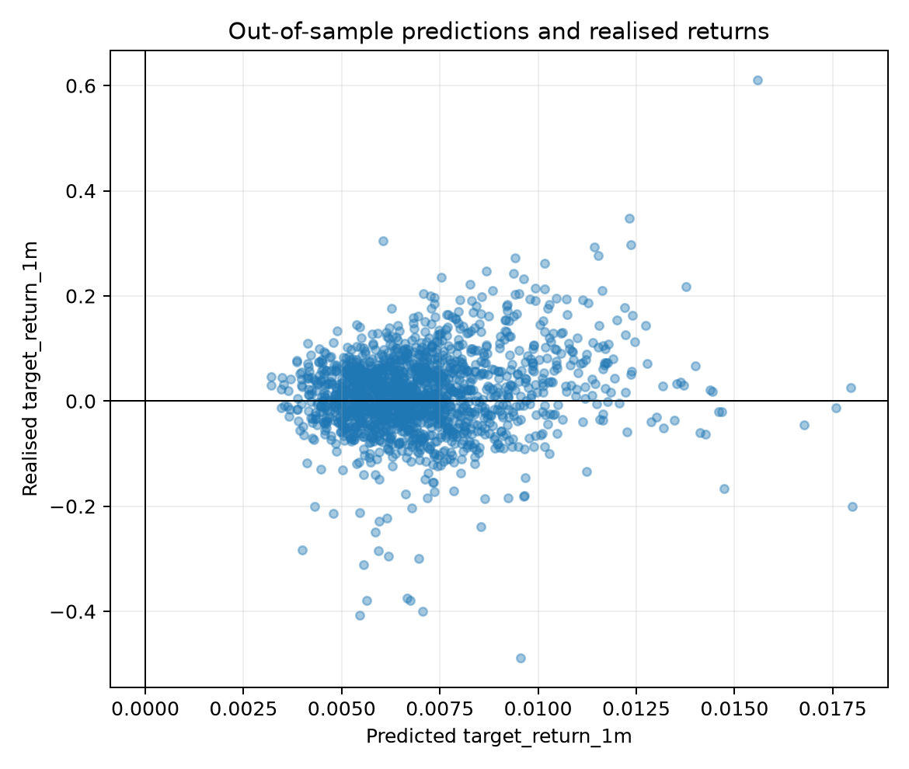
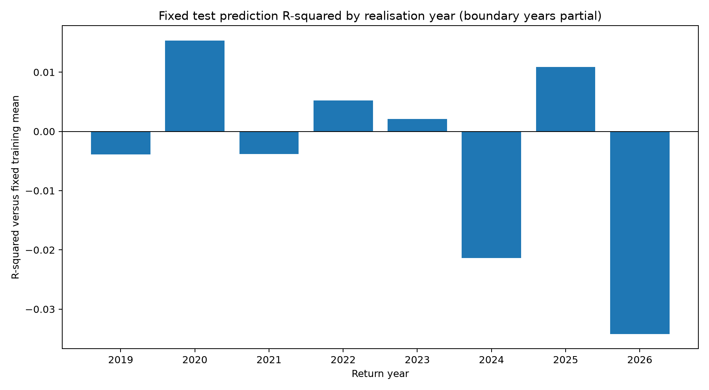
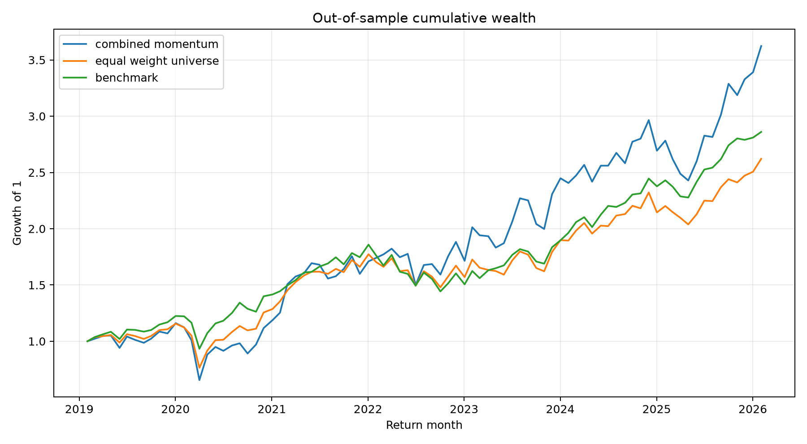
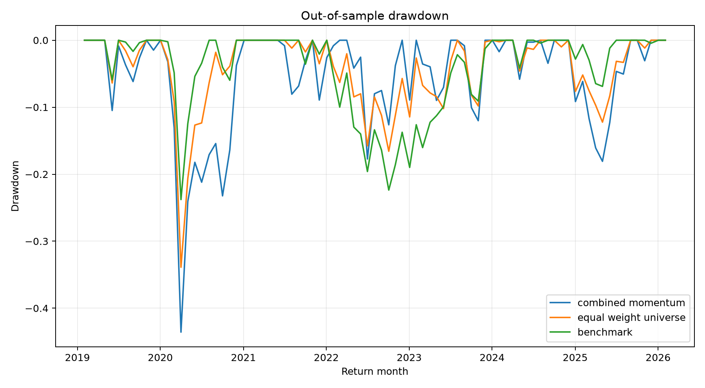
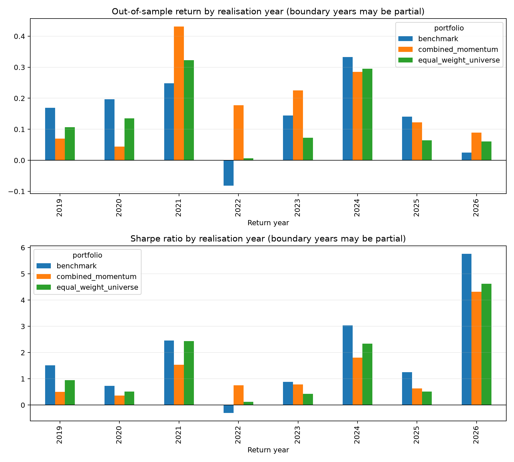

# Three-Signal Rotation across U.S. Industry ETFs

## A Ridge-Based Out-of-Sample Study

**DSA5205 Project 2**

**Group:** 18

**Members:** SEE JIA JIAN, XU HENGYI, YANG YANTING, ZHANG AOKE

**Date:** November 2026

# Abstract

We study whether three simple price-based signals can support monthly rotation across U.S. industry exchange-traded funds. The signals describe the latest one-month price trend, six-month relative strength, and six-month realised volatility. We estimate a common Ridge regression across 20 sector and industry ETFs and use its predicted next-month returns to form a long-only Top-5 portfolio. Signals are formed after each month-end close, trades are executed at the next available close, and portfolio returns include a 10 basis point one-way transaction cost. Model settings are selected with a chronological training and validation design, followed by a fixed out-of-sample test from January 2019 to December 2025.

The strategy earns a post-cost annualised return of 20.19%, compared with 14.76% for the monthly equal-weight ETF universe and 16.20% for buy-and-hold SPY. This higher return is accompanied by 29.95% annualised volatility and a maximum drawdown of 43.57%. Its Sharpe ratio of 0.771 is slightly below the equal-weight portfolio and materially below SPY. Direct forecasting performance is weak: the test-period monthly rank information coefficient is 0.0194 and out-of-sample R-squared is 0.57%. The results show that the three signals can produce a transparent and executable rotation framework, while the observed return advantage is closely connected to concentrated exposure, higher-risk industries, and several favourable periods. Stable forecasting and risk-adjusted superiority are not established by this sample.

# Introduction

Industry returns can differ sharply as economic conditions change. Interest rates affect banks and real estate, commodity prices influence energy and materials, and changes in consumer demand alter the prospects of retail, transportation, and discretionary businesses. These differences create a natural setting for rotation strategies that allocate capital toward industries with more favourable recent conditions.

Momentum research suggests that relative performance can persist across assets and markets, although the strength and horizon of that persistence vary over time (Carhart, 1997; Asness, Moskowitz, and Pedersen, 2013). Short-horizon price movements can also reverse when recent changes reflect temporary pressure rather than lasting information. Volatility adds another dimension because it describes the risk environment in which trend and relative performance are observed. We combine these ideas in a deliberately small feature set. The aim is to keep the strategy interpretable and to make each prediction traceable to a familiar property of the recent price path.

Return prediction is difficult, and small out-of-sample improvements can disappear across periods (Goyal and Welch, 2008; Campbell and Thompson, 2008). Volatility can still matter for portfolio outcomes because risk exposure changes the scale and timing of realised returns (Moreira and Muir, 2017). These findings motivate an evaluation that considers prediction accuracy, compound growth, and risk together.

Our research question is whether the latest one-month trend, six-month relative strength, and six-month volatility can predict the next-month returns of U.S. industry ETFs and support a practical monthly rotation strategy. The prediction task and the investment task are related, although they evaluate different parts of the design. Forecast metrics assess whether the model orders future ETF returns correctly across the entire universe. Portfolio metrics assess the realised outcome of investing in the highest-scoring subset after costs.

We use 20 U.S.-listed sector and industry ETFs and SPY as the broad-market benchmark. A single Ridge model estimates a common relation between the three signals and next-month returns. Ridge regularisation is appropriate for this setting because the signals may overlap and their estimated effects can be unstable in a finite sample. Shrinkage limits coefficient variation while preserving a simple linear interpretation, consistent with the use of regularised models for return prediction in Kelly, Malamud, and Zhou (2024). The regularisation parameter is selected on a chronological validation period using the average monthly Spearman rank correlation between predictions and realised returns.

The final strategy retains ETFs with positive predicted returns, selects the five highest predictions, and assigns a 20% target weight to each selected fund. The model is fixed before the test begins. The test covers 84 monthly decisions from January 2019 through December 2025, with the final holding period ending in February 2026. The portfolio is compared with a monthly rebalanced equal-weight allocation across all 20 ETFs and with buy-and-hold SPY.

The strategy produces the highest cumulative wealth and annualised return in the test period. Its advantage comes with substantially higher volatility, a deeper drawdown, and high turnover. The prediction results are modest and vary across years. These findings motivate a careful distinction between a profitable historical portfolio outcome and a stable forecasting relation. The experiment contributes a complete and reproducible example of how a small set of interpretable signals can be mapped into predictions, positions, trading costs, and out-of-sample evaluation.

# Data and Signal Design

## ETF universe and data source

The candidate universe contains 20 U.S.-listed ETFs representing broad sectors and specialised industries. The broad-sector funds cover consumer discretionary, consumer staples, energy, financials, health care, industrials, information technology, materials, and utilities. The specialised funds add biotechnology, real estate, home construction, banks, regional banks, homebuilders, metals and mining, oil and gas exploration and production, retail, semiconductors, and transportation. SPY is used only as the broad-market benchmark.

| Group | Tickers | Main exposures |
|---|---|---|
| Broad sectors | XLY, XLP, XLE, XLF, XLV, XLI, XLK, XLB, XLU | Consumer, energy, finance, health care, industrials, technology, materials, utilities |
| Specialised industries | IBB, IYR, ITB, KBE, KRE, XHB, XME, XOP, XRT, SMH, IYT | Biotechnology, real estate, construction, banking, mining, energy production, retail, semiconductors, transportation |
| Market benchmark | SPY | Broad U.S. equity market |

Daily adjusted closing prices come from Yahoo Finance. The adjusted series incorporates the vendor's split and distribution adjustments and is used to approximate total returns. The downloaded sample begins in January 2007 and extends to October 2026. The later observations are needed because a signal formed at the end of 2025 produces a holding-period return that is completed in early 2026.

The universe consists of related U.S. equity products, allowing same-date cross-sectional comparison. It also contains overlap between broad sectors and specialised industries. For example, banks and regional banks overlap with the financial sector, while semiconductors overlap with information technology. The 20 tickers therefore provide differentiated industry exposures without representing 20 independent sources of risk.

The historical SMH series requires a specific qualification. Before 21 December 2011, the retained ticker history represents Semiconductor HOLDRS Trust. Participating holders exchanged their receipts for shares of Market Vectors Semiconductor ETF, now VanEck Semiconductor ETF, in December 2011. We retain the predecessor-linked history supplied by Yahoo Finance. This provides a continuous research series while introducing a change in legal instrument and portfolio construction that should be considered when interpreting the long sample.

## Decision time, execution, and prediction target

Signals are formed after the final trading close of each calendar month. The strategy cannot use that closing price and assume execution at the same price. The first available adjusted close after the signal date is used as the simulated execution price. The position is held until the next monthly execution date.

For each ETF and signal month, we denote the next available execution price by P. The prediction target is the realised return between consecutive monthly execution prices:

$$
y_{i,t+1}=\frac{P^{\mathrm{exec}}_{i,t+1}}{P^{\mathrm{exec}}_{i,t}}-1.
$$

This timing creates a clear separation between the information used to form the signal and the price used to enter the position. Features use observations available by the signal close. The label becomes available only after the next holding period ends. This distinction is carried through the training, validation, and test boundaries.

## One-month current-trend rank

The first feature measures the direction of the latest price path. For each ETF, we regress the logarithm of adjusted price on a daily time index over the most recent 21 trading days:

$$
\log P_{i,d}=a_{i,t}+b_{i,t}d+\varepsilon_{i,d},
\qquad
s_{i,t}=252b_{i,t}.
$$

A positive slope indicates that the price generally increased during the month, while a negative slope indicates a downward path. We denote the annualised slope by s. It is converted into a same-month cross-sectional percentile rank, denoted by T, and centred around zero:

$$
T_{i,t}=\frac{\operatorname{rank}(s_{i,t})}{N_t}-0.5.
$$

The rank describes whether an ETF's current trend is stronger or weaker than the trends of the other eligible ETFs. Ranking reduces the influence of scale differences between calm and volatile industries. The one-month horizon captures recent direction without treating a long cumulative return as a direct measure of current trend.

## Six-month relative strength

The second feature measures medium-horizon performance. We calculate the adjusted-price return over six months:

$$
R_{i,t}^{\mathrm{6m}}=\frac{P_{i,t}}{P_{i,t-\mathrm{6m}}}-1.
$$

We denote this six-month return by R. The same-month cross-section is winsorised at the first and ninety-ninth percentiles and then converted to a centred percentile rank M:

$$
M_{i,t}=\frac{\operatorname{rank}(R_{i,t}^{\mathrm{6m}})}{N_t}-0.5.
$$

This signal reflects the idea that industries with stronger medium-term performance may continue to receive favourable capital flows or fundamental news. Its six-month horizon is long enough to differ from the latest one-month direction, allowing the model to combine short-term movement with broader relative performance.

## Six-month realised volatility

The third feature measures recent risk. Using the latest 126 daily adjusted-price returns, we calculate annualised realised volatility:

$$
V_{i,t}=\sqrt{252}\;\operatorname{sd}(r_{i,d}),
\qquad d\in[t-125,t].
$$

The volatility feature is denoted by V and remains in absolute units rather than being converted into a cross-sectional rank. This preserves the difference between genuinely calm and highly variable price paths. We do not impose an expected sign in advance. High volatility may be associated with a risk premium in some periods and with persistent distress in others. The fitted coefficient determines how the training sample maps this risk measure into expected return.

## Data preparation

Daily observations are checked for unique date-ticker pairs, positive adjusted prices, required symbols, and sufficient time coverage. The last available trading date in each calendar month becomes the signal date. Daily data remain available for the 21-day trend and 126-day volatility calculations, while month-end prices support six-month relative strength.

Rows enter the model only when all three features are available and the cross-section contains at least 18 ETFs. Cross-sectional winsorisation is applied before ranking the six-month return. Feature standardisation is estimated from the model's fitting sample and then applied to later observations. This prevents future means and variances from entering earlier model estimates.

# Predictive Model and Experimental Design

## Ridge regression

We pool ETF-month observations and estimate one common linear model. The dependent variable is the next-month return, and the explanatory variables are the three standardised signals. For an observation indexed by ETF and signal month, the model is

$$
\hat y_{i,t+1}=\beta_0+\beta_1 T_{i,t}
+\beta_2 M_{i,t}
+\beta_3 V_{i,t}.
$$

The Ridge estimator minimises squared prediction errors with an L2 penalty:

$$
\min_{\beta_0,\boldsymbol{\beta}}
\sum_{i,t}\left(y_{i,t+1}-\beta_0-\mathbf{x}_{i,t}^{\mathrm{T}}\boldsymbol{\beta}\right)^2
+\alpha\sum_{j=1}^{3}\beta_j^2.
$$

The penalty discourages large coefficients and stabilises the model when signals share information. Each feature is standardised using the mean and standard deviation estimated from the relevant fitting sample. Standardised coefficients can therefore be compared by magnitude within the final model.

## Chronological sample design

The sample is divided by signal date. Training observations extend through December 2014, validation observations run from January 2015 through December 2018, and final test signals run from January 2019 through December 2025.

| Stage | Signal period | Role |
|---|---|---|
| Training | July 2007 to December 2014 | Estimate candidate Ridge models and feature scaling |
| Validation | January 2015 to December 2018 | Select the regularisation parameter |
| Test | January 2019 to December 2025 | Evaluate fixed predictions and trading outcomes |

The use of signal dates alone is insufficient at the boundaries because a month-end row carries a future return label. Candidate fitting therefore uses only training labels revealed by the first validation signal. The December 2014 signal is excluded from candidate fitting because its return is completed in February 2015. The final refit uses training and validation labels available by the first test signal. The December 2018 signal is excluded because its return is completed after the January 2019 test signal. The resulting candidate training sample has 1,780 ETF-month observations, the validation sample has 940 observations, and the final refit uses 2,740 observations.

## Validation and model selection

The pre-declared Ridge grid contains alpha values 0.01, 0.1, 1, 10, and 100. For each value, a model is fitted on the eligible training sample and used to score the validation sample. Selection uses the average monthly Spearman correlation between predicted and realised cross-sectional return ranks. This criterion matches the later Top-5 rule more closely than a purely level-based loss because the portfolio depends on relative ordering.

| Alpha | Validation rank IC | Validation MSE |
|---:|---:|---:|
| 0.01 | -0.06764 | 0.003174 |
| 0.10 | -0.06764 | 0.003174 |
| 1.00 | -0.06805 | 0.003174 |
| 10.00 | -0.06805 | 0.003174 |
| 100.00 | -0.06879 | 0.003174 |

Alpha 0.1 is selected. Its validation rank IC ties with alpha 0.01 at the displayed precision and has a marginally lower validation MSE. All five validation IC values are negative and close together, showing that the validation ranking is weak and largely unchanged across the regularisation grid.

After selection, the scaler and Ridge model are refitted on all eligible training and validation observations. This fixed model generates every test prediction throughout the test period.

## Fitted signal relation

The final standardised coefficients summarise how the refitted model combines the signals.

| Feature | Standardised coefficient | Direction in the fitted model |
|---|---:|---|
| Six-month realised volatility | 0.002248 | Higher volatility increases the predicted return |
| One-month current-trend rank | -0.000791 | A stronger recent trend reduces the predicted return |
| Six-month relative-strength rank | 0.000408 | Stronger medium-term performance increases the predicted return |

The fitted relation combines medium-term continuation with short-term reversal. The largest coefficient belongs to realised volatility, so the model also favours higher-risk industries. These values describe the fitted scoring rule. Their economic stability is assessed through later prediction and portfolio results.

## Computational environment

The project uses Python 3.12 for the recorded model and evaluation runs. The main packages are pandas, NumPy, scikit-learn, SciPy, matplotlib, PyYAML, joblib, and requests. The random seed is fixed at 5205. Model settings, sample dates, feature windows, trading rules, and benchmark choices are stored in a single project configuration so the same analysis can be reproduced across environments.

# Portfolio Construction and Evaluation Design

## From predictions to positions

At each test signal date, the model produces a predicted next-month return for every candidate ETF. ETFs with a positive prediction are ranked from highest to lowest. The strategy selects at most five and assigns each selected ETF a 20% target weight. Unused allocation remains in cash, producing a long-only and unleveraged portfolio.

At least five ETFs receive positive predictions at every test signal, so the strategy holds five funds in every test month. The cash fallback remains inactive in the realised test path. Alphabetical ticker order resolves any exact prediction ties.

## Execution, rebalancing, and costs

Positions are rebalanced at the first available adjusted close after each month-end signal. Existing holdings drift with their realised returns before the next rebalance. The strategy then trades from drifted pre-trade weights to the new target weights.

Purchases and sales incur a 10 basis point one-way cost. The pre-trade weights and desired after-cost target weights enter a self-financing portfolio budget, which determines the cost fraction:

$$
c_t=0.001\sum_i\left|(1-c_t)w_{i,t}^{\mathrm{target}}-w_{i,t}^{\mathrm{pre}}\right|.
$$

The executed weights and transaction costs therefore remain self-financing. Cash transfers do not incur a fee, and there is no terminal liquidation. Ending wealth is marked to market at the final holding-period close. Monthly turnover is the total absolute ETF trade amount as a fraction of pre-trade wealth.

The return calculation includes the cash allocation and subtracts costs through the self-financing budget. Adjusted closing prices approximate executable total-return prices. Taxes, bid-ask variation, market impact, and intramonth trading are outside the model.

## Benchmarks

The first benchmark is a monthly rebalanced equal-weight portfolio of the 20 candidate ETFs. Each fund receives a 5% target weight, and the same drift and cost accounting is applied. This comparison measures whether model-based concentration adds value relative to holding the full industry universe.

The second benchmark is buy-and-hold SPY. SPY is purchased once at the beginning of the test, pays the same entry fee, and is then held. It represents a liquid and readily investable alternative for broad U.S. equity exposure.

## Evaluation measures

Prediction performance is evaluated using RMSE, MAE, out-of-sample R-squared against the fixed historical training-label mean, and average monthly Spearman rank IC. RMSE and MAE measure errors in predicted return levels. R-squared compares prediction errors with a simple historical-mean forecast. Rank IC measures whether the cross-sectional ordering of predictions agrees with the ordering of realised returns.

Portfolio performance is evaluated after costs. Annualised return is the geometric compound growth rate using 12 monthly periods per year. Annualised volatility is the sample standard deviation of monthly returns multiplied by the square root of 12. The Sharpe ratio uses a zero risk-free rate. Maximum drawdown measures the largest loss from a previous monthly wealth peak, including initial wealth of one. Turnover and cumulative transaction-cost fractions describe the trading intensity of each portfolio.

# Empirical Results

## Out-of-sample prediction performance

The prediction results show limited explanatory power across all three stages.

| Sample | Observations | RMSE | MAE | R-squared | Monthly rank IC |
|---|---:|---:|---:|---:|---:|
| Training | 1,780 | 0.08305 | 0.05944 | 0.00059 | -0.02340 |
| Validation | 940 | 0.05634 | 0.04189 | 0.00045 | -0.06764 |
| Test | 1,680 | 0.07783 | 0.05610 | 0.00571 | 0.01942 |

The test R-squared is positive at 0.57%, indicating a small reduction in squared error relative to the fixed training-mean forecast. The monthly test rank IC is also positive, although its magnitude is close to zero. The negative validation IC and small positive test IC show that the cross-sectional relation changes between periods.

The prediction scatter in Figure 1 illustrates this weak relation. Predicted returns occupy a narrow positive range, while realised returns display much wider dispersion. The model captures only a small part of month-to-month industry return variation.



Prediction performance also varies over time. Annual R-squared is positive in 2020, 2022, 2023, and 2025, and negative in the remaining displayed years. The boundary years contain fewer observations because returns are grouped by holding-period completion date.



## Portfolio performance

The Top-5 strategy produces the highest annualised and cumulative return over the 84 test months.

| Investment after costs | Annualised return | Annualised volatility | Sharpe | Maximum drawdown | Cumulative return |
|---|---:|---:|---:|---:|---:|
| Three-signal Top-5 | 20.19% | 29.95% | 0.771 | -43.57% | 262.35% |
| Equal-weight universe | 14.76% | 20.70% | 0.775 | -33.89% | 162.14% |
| Buy-and-hold SPY | 16.20% | 17.26% | 0.962 | -23.79% | 186.04% |

One unit invested in the strategy grows to 3.6235, compared with 2.6214 for the equal-weight universe and 2.8604 for SPY. Figure 3 shows that the paths remain relatively close through the early part of the test and separate more clearly after 2022. The strategy finishes with the highest wealth, while its path exhibits larger month-to-month changes.



The additional return is accompanied by higher risk. Strategy volatility is almost 30%, compared with about 21% for equal weight and 17% for SPY. Its Sharpe ratio is slightly below the equal-weight portfolio and materially below SPY. The drawdown comparison in Figure 4 shows the same pattern. The strategy's maximum monthly-end drawdown reaches 43.57%, with the deepest decline occurring during the 2020 market shock. Later drawdowns also tend to be larger than those of the benchmarks.



The strategy rebalances actively. Average monthly turnover is 89.48% of pre-trade wealth, and the sum of monthly cost fractions is 7.52 percentage points. The equal-weight portfolio has 4.74% average monthly turnover, while SPY trades only at entry. The cost total describes the sum of monthly fee fractions and does not equal a standalone dollar loss or the difference between gross and net compound returns.

## Performance across years

Annual outcomes vary considerably. The strategy underperforms both benchmarks in 2019 and 2020. It earns 43.09% in 2021, followed by 17.78% in 2022 and 22.51% in 2023. The 2022 result is particularly distinctive because SPY loses 8.20% while the equal-weight universe is close to flat. In 2024, all three investments perform strongly and the strategy trails both benchmarks. In 2025, it exceeds the equal-weight universe and trails SPY.

| Realisation year | Strategy return | Equal-weight return | SPY return | Strategy volatility |
|---:|---:|---:|---:|---:|
| 2020 | 4.43% | 13.48% | 19.72% | 57.90% |
| 2021 | 43.09% | 32.31% | 24.81% | 25.66% |
| 2022 | 17.78% | 0.62% | -8.20% | 26.06% |
| 2023 | 22.51% | 7.29% | 14.47% | 31.57% |
| 2024 | 28.53% | 29.48% | 33.26% | 14.60% |
| 2025 | 12.24% | 6.42% | 14.07% | 21.71% |

Figure 5 presents annual returns and Sharpe ratios, including the partial boundary years. The strongest relative strategy performance appears in 2022 and 2023. The high 2021 return also carries more risk than the benchmarks, producing a lower Sharpe ratio despite the larger gain. The two observations assigned to 2026 provide only a partial-period description and do not support a stable annual comparison.



# Discussion

## Return performance and its quality

The most visible result is the strategy's 20.19% annualised return. It exceeds the equal-weight universe by 5.43 percentage points per year and SPY by 3.99 percentage points. The cumulative wealth difference becomes substantial by the end of the test, showing that the combined signals and Top-5 rule identified a profitable sequence of industry allocations during this period.

Return alone gives an incomplete view of the outcome. The strategy accepts substantially more volatility and a deeper drawdown. Its Sharpe ratio remains close to the equal-weight portfolio and below SPY. The higher cumulative return therefore reflects a more aggressive return path rather than a broad improvement across return and risk measures.

The prediction evidence is similarly measured. Test R-squared and rank IC are positive but small, while validation rank IC is negative. The model does not consistently order all 20 next-month ETF returns. The profitable portfolio outcome and the weak average prediction metrics can coexist because they evaluate different aspects of the experiment.

## Economic interpretation of the fitted signals

The largest standardised coefficient belongs to six-month volatility and is positive. Within the fitted model, ETFs with higher recent volatility receive higher expected returns. This creates a natural tilt toward riskier industries. When these industries perform well, a concentrated Top-5 portfolio can earn more than a diversified benchmark. The same exposure increases monthly variation and potential losses, matching the observed volatility and drawdown results.

The one-month trend coefficient is negative, while the six-month relative-strength coefficient is positive. The model combines short-term reversal with medium-term continuation. This pattern is economically plausible because recent price pressure can reverse even while a broader industry trend remains intact. Its predictive contribution is limited in the current sample, as shown by the small out-of-sample metrics.

Industry returns also respond to information that is absent from the three price signals. Interest-rate changes, energy prices, regulation, earnings news, and shifts in risk appetite can quickly change relative industry performance. Historical trend and volatility summarise the market's recent state, but their relation with the following month can change when the economic environment changes.

## Concentration and changing market conditions

Rank IC evaluates the ordering of the full 20-ETF cross-section. The portfolio depends mainly on the five highest scores. A model can therefore produce a weak average ordering while still selecting several strong performers in influential months. Concentration magnifies the effect of those selections on wealth.

The annual results suggest that a limited number of periods contribute heavily to the return advantage. The strategy performs especially well relative to the benchmarks in 2022 and 2023, years with substantial differences across industries. It performs less favourably in 2019 and 2020, and its 2024 return is slightly below both benchmarks during a broadly strong market. Industry rotation appears more useful when sector outcomes diverge and less useful when diversified market exposure captures the prevailing advance efficiently.

The fixed linear model adds another source of variation. A single coefficient vector is used throughout the seven-year test. The meaning of trend, relative strength, and volatility can change across market regimes, while the model cannot adjust after the test begins. The similar validation results across the alpha grid also show that changing shrinkage strength alone does not resolve this instability.

## Practical value and limitations

The framework remains practical. It uses public price data, three transparent signals, a monthly schedule, and a clear mapping from predictions to holdings. The portfolio is long-only, unleveraged, and explicitly accounts for trading costs. These features make the experiment easy to understand and reproduce.

Its strongest value lies in providing a disciplined industry-allocation process. The model combines information across different horizons, produces comparable scores, and translates those scores into a consistent portfolio rule. The test demonstrates that this process can generate strong compound growth in a realistic historical simulation.

The result is sensitive to risk concentration and market conditions. Broad sector funds overlap with specialised industry funds, so five tickers may represent fewer than five independent economic exposures. The ETF universe was assembled retrospectively, and the SMH history contains a predecessor instrument. Adjusted-close execution, a constant transaction-cost rate, and a zero cash return simplify real trading. The fixed model also becomes less responsive as the test moves further from the estimation period.

These considerations limit how far the historical return advantage can be generalised. More adaptive estimation and direct risk controls could improve stability, although they would introduce additional model choices that require fresh validation. Within the current design, the evidence supports a transparent and executable rotation framework. Stable forecasting and superior risk-adjusted performance remain open questions.

# Conclusion

We tested a monthly rotation strategy across 20 U.S. sector and industry ETFs using one-month trend rank, six-month relative-strength rank, and six-month realised volatility. Ridge regression combined the signals into next-month return forecasts, and a positive-prediction Top-5 rule converted those forecasts into a long-only portfolio. Chronological training, validation, and test periods separated model selection from final evaluation, while next-close execution and transaction costs connected the prediction exercise to an investable strategy.

The strategy achieved the highest annualised and cumulative return in the test period. Its 20.19% annualised return exceeded both the equal-weight ETF universe and SPY. This outcome came with higher volatility, a maximum drawdown of 43.57%, and a Sharpe ratio below SPY. Prediction metrics were positive but small in the test and negative in validation, indicating weak and unstable average forecasting ability.

The results are consistent with a portfolio that benefits from concentrated exposure to higher-risk industries during favourable periods. The method provides a clear and reproducible framework for industry allocation, and the experiment shows how interpretable signals can be carried from data construction through model fitting and portfolio accounting. The current evidence supports practical feasibility while leaving substantial room for improved risk control and adaptation to changing market conditions.

# Contribution Note

| Member | Main contribution |
|---|---|
| SEE JIA JIAN | Data processing, feature construction, and video presentation of this part |
| XU HENGYI | Model training, validation, and video presentation of this part |
| YANG YANTING | Trading-rule implementation, backtesting, final testing, and video presentation of this part |
| ZHANG AOKE | Initial codebase and project framework, task coordination, result integration and summary, report compilation, and video presentation of this part |

# References

Asness, C. S., Moskowitz, T. J., and Pedersen, L. H. (2013). Value and momentum everywhere. *Journal of Finance*, 68(3), 929–985.

Campbell, J. Y., and Thompson, S. B. (2008). Predicting excess stock returns out of sample: Can anything beat the historical average? *Review of Financial Studies*, 21(4), 1509–1531.

Carhart, M. M. (1997). On persistence in mutual fund performance. *Journal of Finance*, 52(1), 57–82.

Goyal, A., and Welch, I. (2008). A comprehensive look at the empirical performance of equity premium prediction. *Review of Financial Studies*, 21(4), 1455–1508.

Kelly, B. T., Malamud, S., and Zhou, K. (2024). The virtue of complexity in return prediction. *Journal of Finance*, 79(1), 459–501.

Moreira, A., and Muir, T. (2017). Volatility-managed portfolios. *Journal of Finance*, 72(4), 1611–1644.

State Street Global Advisors. SPDR sector and industry ETF information. https://www.ssga.com/us/en/intermediary/etfs

iShares. U.S. sector and industry ETF information. https://www.ishares.com/us/products/etf-investments

VanEck. Semiconductor ETF information and Semiconductor HOLDRS transition notice. https://www.vaneck.com/us/en/investments/semiconductor-etf-smh/

Yahoo Finance. Historical adjusted price data. https://finance.yahoo.com/

# Appendix: Reproducibility

The recorded analysis uses run ID `20261024T155915Z_final_us_industry_project`. From the repository root, the completed model can be reproduced with the recorded data and environment. The final backtest and evaluation use the saved model predictions and do not retrain the model.

```powershell
python -m venv .venv
.venv\Scripts\Activate.ps1
python -m pip install -r requirements.txt
python scripts\run_pipeline.py --config configs\final_us_industry_project.yaml --stage backtest --run-id 20261024T155915Z_final_us_industry_project
python scripts\run_pipeline.py --config configs\final_us_industry_project.yaml --stage evaluate --run-id 20261024T155915Z_final_us_industry_project
```

The backtest produces positions, trades, monthly portfolio returns, benchmark returns, transaction costs, performance tables, and figures. The evaluation uses the same saved predictions and run identifier throughout.

