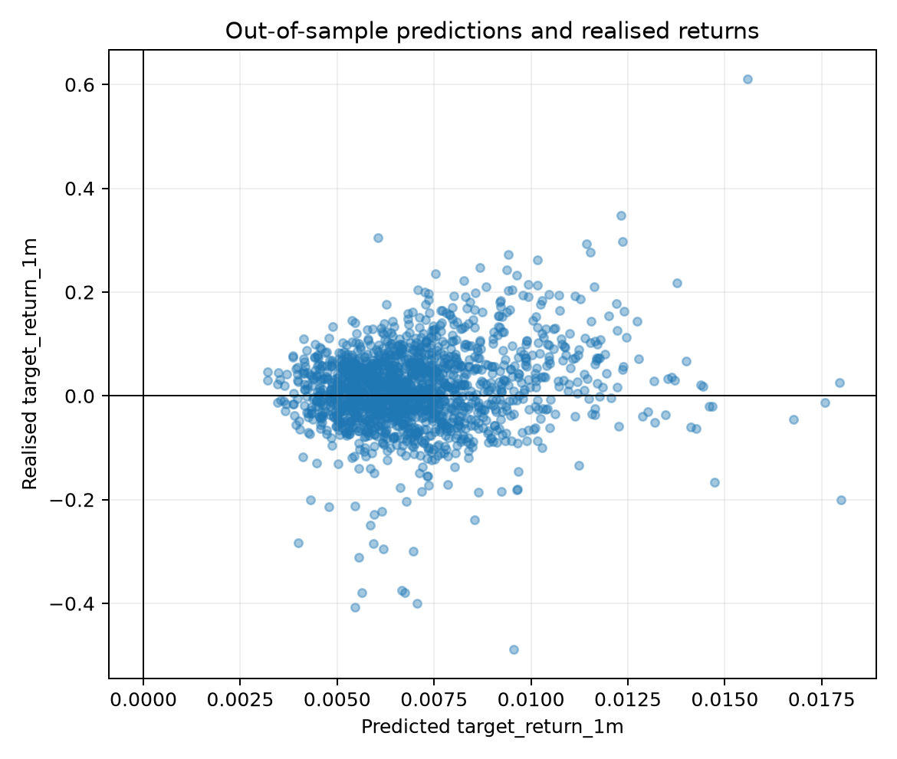
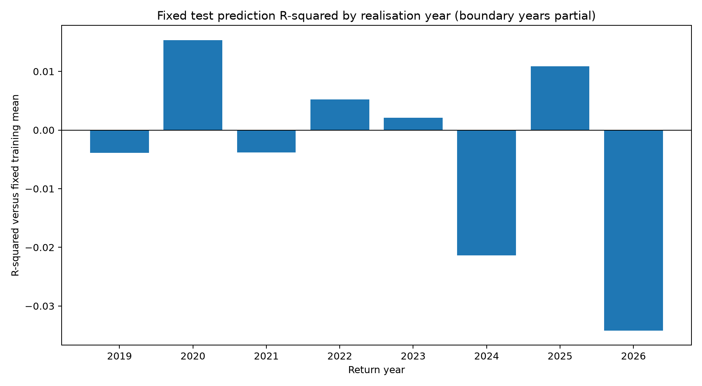
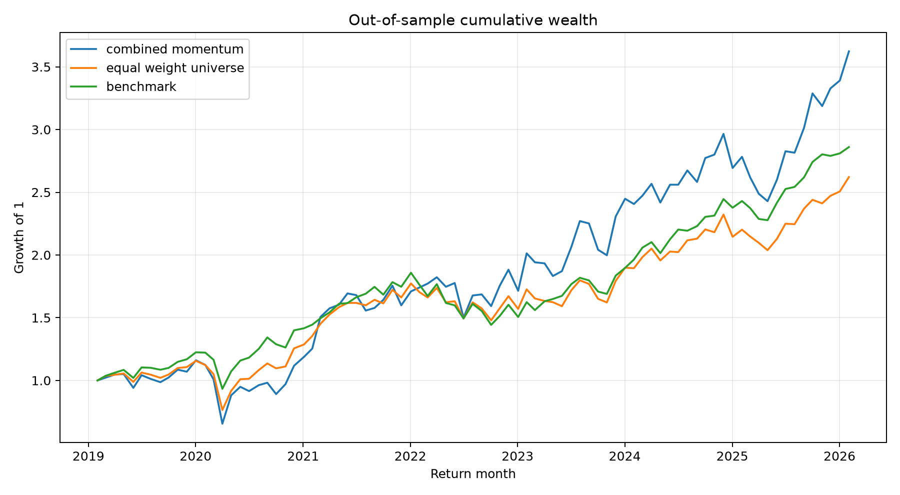
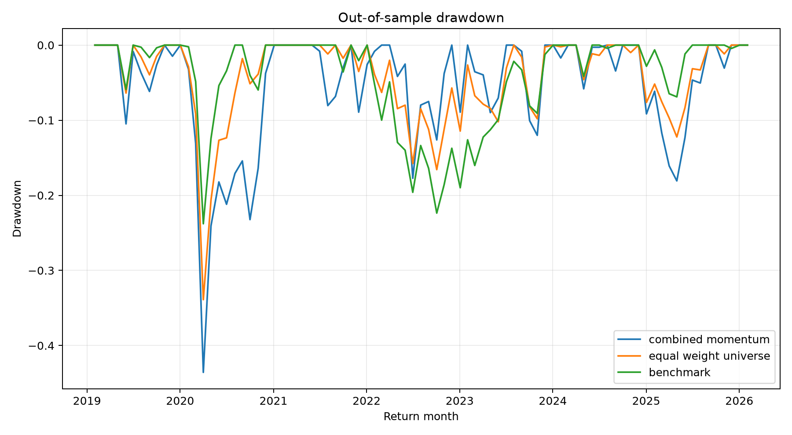
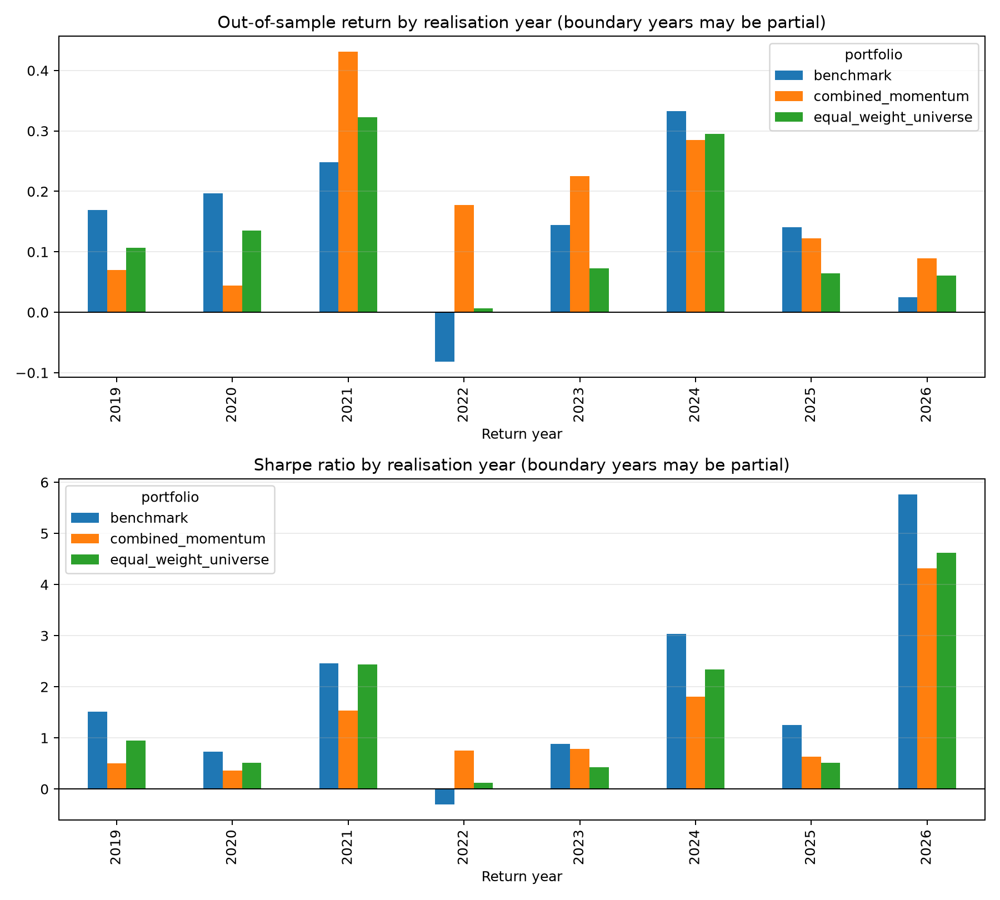

# 美国行业 ETF 三信号轮动策略

## Ridge 模型与样本外实验报告中文简版

**课程：** DSA5205 Project 2

**小组：** Group 18

**成员：** SEE JIA JIAN、XU HENGYI、YANG YANTING、ZHANG AOKE

# 摘要

我们研究三个简单的价格信号能否用于美国行业 ETF 的月度轮动。三个信号分别描述最近一个月的价格趋势、最近六个月的相对强弱，以及最近六个月的实际波动率。我们使用20只美国宽行业和细分行业 ETF，通过 Ridge 回归预测下一期收益，再根据预测结果构建长期持有五只 ETF 的月度组合。

策略在2019年至2025年的测试信号期内取得20.19%的年化收益，高于20只ETF等权组合的14.76%和SPY的16.20%。这一收益伴随着29.95%的年化波动率和43.57%的最大回撤。策略Sharpe为0.771，略低于等权组合，也明显低于SPY。模型在测试期的排名IC为0.0194，样本外R²为0.57%，说明平均预测能力较弱。整体结果表明，三个信号可以形成一套透明且能够执行的行业轮动方法，但其收益与较高风险暴露、集中持仓和部分有利年份密切相关。

# 研究问题与整体设计

不同行业会对利率、能源价格、消费需求和经济周期产生不同反应，因此行业之间经常出现明显的收益差异。我们希望判断近期价格趋势、中期相对表现和风险状态是否包含下个月收益的信息。

我们的研究问题是，三个可解释的价格特征能否帮助预测美国行业 ETF 的下月收益，并形成具有实际可执行性的月度轮动组合。

研究使用20只美国行业ETF作为候选资产，SPY作为宽基准。每个月末收盘后形成特征和预测，在下一个可用交易日收盘成交，并持有到下一次月度成交日。数据用于训练、验证和最终测试，模型参数只在训练与验证阶段确定。

# 数据与特征

每日调整收盘价来自Yahoo Finance，样本从2007年开始。调整价格用于计算收益、趋势和波动率。候选池包含9只宽行业ETF和11只细分行业ETF，覆盖消费、能源、金融、医疗、工业、科技、材料、公用事业、房地产、银行、零售、半导体和运输等领域。

SMH在2011年以前对应Semiconductor HOLDRS Trust，之后转换为现在的半导体ETF。我们保留Yahoo提供的连续历史序列，同时在报告中说明这一前身关系。

预测目标是相邻两个月度成交价格之间的实际收益：

$$
y_{i,t+1}=\frac{P^{exec}_{i,t+1}}{P^{exec}_{i,t}}-1.
$$

一个月趋势特征使用最近21个交易日的对数价格斜率，并转换成同月横截面排名。它表达一只ETF当前的上升或下降趋势相对于其他ETF更强还是更弱。

六个月相对强弱使用当前调整价格相对于六个月前价格的收益，并在同月进行缩尾和排名。它表达一只ETF的中期表现相对于其他行业更强还是更弱。

六个月波动率使用最近126个日收益的年化标准差。该特征保留绝对数值，用来区分平稳行业和高波动行业。

# 模型与实验方法

我们使用统一的Ridge回归模型学习三个特征和下一期收益之间的关系。Ridge在平方误差中加入系数惩罚，使模型在特征存在重叠信息时更加稳定。

$$
\min_{\beta_0,\boldsymbol{\beta}}
\sum_{i,t}\left(y_{i,t+1}-\beta_0-\mathbf{x}_{i,t}^{\mathrm{T}}\boldsymbol{\beta}\right)^2
+\alpha\sum_{j=1}^{3}\beta_j^2.
$$

训练信号截止2014年12月，验证期为2015年至2018年，测试期为2019年至2025年。边界月份按照未来收益的实际揭晓时间处理，避免模型使用当时尚未出现的标签。

我们预先设置0.01、0.1、1、10和100五个alpha，通过验证期平均月度排名IC选择模型。最终选择alpha=0.1。五个alpha的验证IC都接近−0.068，说明正则化强度的变化没有明显改善验证期排序表现。

最终模型中，六个月波动率系数为正且绝对值最大，一个月趋势系数为负，六个月相对强弱系数为正。模型因此表现为中期延续、短期反转和偏向高波动行业的组合。

# 交易与评价方法

每个信号月先保留预测收益为正的ETF，再按照预测值从高到低选择最多五只。每只目标权重为20%，未投入部分保留为现金。实际测试中每个月都有至少五只ETF满足条件，因此组合始终持有五只ETF。

策略在下一个交易日收盘进行月度再平衡。已有持仓先随当月收益发生权重漂移，再交易到新的目标权重。ETF买入和卖出均收取10bp单边成本，费用从组合财富中支付。

比较对象包括每月恢复到5%单只权重的20只ETF等权组合，以及买入并持有SPY。预测评价使用RMSE、MAE、样本外R²和月度排名IC。组合评价使用扣除成本后的年化收益、波动率、Sharpe、最大回撤、累计收益和换手率。

# 实验结果

## 预测结果

| 数据阶段 | 样本数 | RMSE | R² | 月度排名IC |
|---|---:|---:|---:|---:|
| 训练 | 1,780 | 0.08305 | 0.00059 | -0.02340 |
| 验证 | 940 | 0.05634 | 0.00045 | -0.06764 |
| 测试 | 1,680 | 0.07783 | 0.00571 | 0.01942 |

测试期R²和排名IC略为正值，但都接近零。验证期排名IC为负，测试期转为小幅正值，说明三个信号与下月收益之间的关系随时期变化，整体预测能力较弱。

年度R²在不同年份正负交替。2020年和2025年相对较好，2024年明显为负，进一步说明模型效果并不稳定。

## 组合结果

| 组合 | 年化收益 | 年化波动率 | Sharpe | 最大回撤 | 累计收益 |
|---|---:|---:|---:|---:|---:|
| 三信号Top-5策略 | 20.19% | 29.95% | 0.771 | -43.57% | 262.35% |
| 20只ETF等权组合 | 14.76% | 20.70% | 0.775 | -33.89% | 162.14% |
| 买入并持有SPY | 16.20% | 17.26% | 0.962 | -23.79% | 186.04% |

策略取得最高的年化收益和累计收益。一单位初始资金最终增长到3.6235，等权组合和SPY分别增长到2.6214和2.8604。

策略同时承担了最高的波动率和最大回撤。其Sharpe略低于等权组合，并明显低于SPY，因此较高收益没有带来更好的风险调整表现。

年度结果显示，策略在2022年和2023年相对表现突出。2022年策略取得17.78%的正收益，而SPY下跌8.20%。2019和2020年策略表现较弱，2024年也略低于两个基准。收益优势主要来自部分市场阶段，并没有平均分布在整个测试期。

# 结果分析

策略20.19%的年化收益说明三个信号和Top-5规则在测试期捕捉到了一些有利的行业配置机会。累计财富在2022年以后与两个基准逐渐拉开，证明这一方法能够形成具有实际意义的组合结果。

收益需要和风险及预测表现一起理解。策略的波动率接近30%，最大回撤超过43%，Sharpe没有超过两个基准。预测指标也显示模型无法稳定排列20只ETF的下月表现。

现实市场环境可以解释这种差异。行业收益受到利率、商品价格、政策、盈利消息和风险偏好影响，三个历史价格特征只能概括市场近期状态。模型中波动率的正系数最大，使组合更容易选择高风险行业。Top-5规则进一步提高了集中度，因此在有利时期能够放大收益，在不利时期也会产生更大波动和回撤。

排名IC评价全部20只ETF的整体顺序，而组合收益主要由最终持有的五只ETF决定。即使完整排序较弱，只要几个重要时期选中了表现较好的行业，累计财富仍然可能明显提高。2022年和2023年的结果体现了这种情况。

模型在整个测试期使用同一组线性系数，而趋势、相对强弱和波动率的含义会随经济环境变化。五个alpha的验证结果非常接近，也说明仅调整正则化强度无法解决这种阶段性变化。

这套方法仍然具有实际价值。它使用公开数据，特征含义清楚，月度交易频率适中，持仓规则透明，交易成本也进入了计算。实验建立了一套完整的行业轮动框架，可以将不同时间尺度的价格信息转换成统一评分和实际组合。当前结果支持该框架的可执行性，也表明风险控制和模型适应性仍有改进空间。

# 结论

我们使用一个月趋势排名、六个月相对强弱和六个月波动率预测20只美国行业ETF的下月收益，并通过Ridge回归和Top-5规则形成月度轮动组合。

策略在测试期取得20.19%的年化收益，高于等权组合和SPY。较高收益伴随着更高波动、更深回撤和较高换手率。预测指标整体较弱，策略的Sharpe也没有超过SPY。

实验说明三个简单信号能够支持一套透明、可复现且能够执行的行业配置方法。测试期收益显示了该框架的潜在价值，风险和预测结果则说明其稳定性仍然有限。

